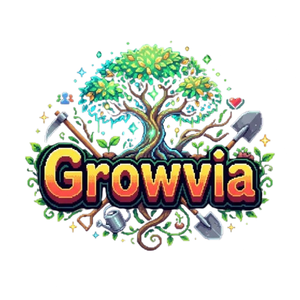

# Growvia



> Game idle-grind untuk Discord (discord.js v14): bertani, menambang, memancing, dan dungeon.  
> Dirancang untuk dimainkan **bertahun-tahun**: ekonomi seimbang, banyak sink Viaz, pencapaian, quest harian, koleksi, peringkat, dan Ascension.

<p align="center">
  <a></a>
  <a></a>
  <a></a>
</p>

---

## Ringkasan

| Aktivitas | Syarat | Gaya main |
|---|---|---|
| 🌾 **Farming** | - | Tanam, tunggu waktu nyata, panen, jual. Auto-Tanam di Lv 10 |
| ⛏️ **Mining** | Farming Lv 10 + beli Beliung | Ekspedisi gua, 15 ore. Auto-Mine di Mining Lv 10 |
| 🎣 **Fishing** | Farming Lv 30 + Mining Lv 20 + beli Pancingan | AFK selama umpan masih ada, 1 ikan = 1 slot, bobot (lbs) |
| 🔮 **Dungeon** | Farming 30 + Mining 20 + Fishing 10 + senjata | **Full manual**, turn-based, boss, mekanik *charge* |

- **1 aktivitas aktif** pada satu waktu (saling mengunci).
- **Gratis hanya**: Cangkul Pemula + 100 benih Gandum. Semua lainnya dibeli dengan **Viaz**.
- **Rarity global** hanya 5: Common, Uncommon, Rare, Epic, Legendary.
- **Bahasa**: tampilan publik selalu **English**. Thread, menu, dan error pribadi mengikuti bahasa akun (English default, atau Bahasa Indonesia).
- **UI**: Discord **Components V2**, semua tombol abu-abu di dalam container.
- **Thread pribadi**: pemain boleh punya banyak thread (satu per aktivitas) dan tombol/perintah chat bisa dipakai dari thread mana pun miliknya — tidak perlu reset thread. Thread dihapus otomatis hanya bila akun benar-benar idle > 5 menit; progres tetap aman di database dan settle latar jalan tiap menit (maksimal 24 jam offline).

---

## Channel

Panel publik dipasang otomatis di tiap channel (ID di `.env`).

| Channel | Env | Isi |
|---|---|---|
| Akun | `ACCOUNT_CHANNEL_ID` | Buat akun + pilih bahasa |
| Farming / Toko Tani | `FARM_CHANNEL_ID` / `SHOP_CHANNEL_ID` | Thread farm / benih, jual panen, plot, cangkul |
| Mining / Toko Tambang | `MINING_CHANNEL_ID` / `MINING_SHOP_CHANNEL_ID` | Thread gua / jual ore, beliung |
| Fishing / Toko Pancing | `FISHING_CHANNEL_ID` / `FISHING_SHOP_CHANNEL_ID` | Thread dermaga / umpan, pancingan, jual ikan |
| Dungeon / Toko Dungeon | `DUNGEON_CHANNEL_ID` / `DUNGEON_SHOP_CHANNEL_ID` | Thread dungeon / senjata, armor, ramuan, jual loot |
| Armory | `BACKPACK_CHANNEL_ID` | Upgrade tas, buang item |
| **Hall** | `HALL_CHANNEL_ID` | Profil, quest, achievement, koleksi, peringkat, Ascension |
| **Boosts** | `BOOSTS_CHANNEL_ID` | Toko booster Viaz (konsumsi sementara per skill) |
| **Suggestions** | `SUGGEST_CHANNEL_ID` | Form saran & laporan bug (tombol → modal → postingan berformat + vote) |
| Logs | `LOG_CHANNEL_ID` | Peringatan kesehatan bot (opsional) |

---

## Ekonomi

Semua angka ada di `src/data/*` dan `src/config/game.js`. Tuning diverifikasi oleh simulasi (`npm run sim`) dan dijaga oleh `test/balance-check.js`.

### Prinsip

- **Paritas aktivitas**: XP/jam dan Viaz/jam tiap aktivitas dijaga seimbang. Tidak ada aktivitas yang wajib atau mati. Fishing (AFK) sengaja ±50-65% pendapatan Farming.
- **Halving**: total Viaz yang tercetak lewat penjualan menentukan kurs global (×0.5 tiap 10 juta, interval berlipat, minimal ×0.01). Kurs berlaku untuk **penjualan dan semua harga beli** (benih, umpan, ramuan, alat, plot, tas, biaya dungeon), jadi ekonomi tetap sehat setelah halving.
- **Sink Viaz** berulang: umpan, benih, ramuan, biaya masuk dungeon, alat bertingkat (3-25 jam pendapatan saat terbuka), plot (`500 × 1.015^n`), tas (`150 × 1.35^n`).
- **Anti farming dungeon mudah**: hadiah turun 4% per level di atas batas 15 level dari level buka dungeon (minimal 20%).
- **Level 100** sengaja butuh ±2.000-3.400 jam per skill (kurva `20 × L³`).

### Benih

| Benih | Rarity | Unlock | Tumbuh | Beli | Jual | XP |
|---|---|---|---|---|---|---|
| 🌾 Wheat | Common | Lv 1 | 1 mnt | 1 | 2 | 1 |
| 🥕 Carrot | Common | Lv 5 | 5 mnt | 5 | 12 | 6 |
| 🥔 Potato | Uncommon | Lv 10 | 15 mnt | 15 | 38 | 20 |
| 🍅 Tomato | Uncommon | Lv 20 | 30 mnt | 32 | 82 | 44 |
| 🌽 Corn | Rare | Lv 30 | 1 jam | 70 | 180 | 100 |
| 🍓 Strawberry | Rare | Lv 40 | 2 jam | 150 | 400 | 225 |
| 🎃 Pumpkin | Epic | Lv 50 | 4 jam | 330 | 880 | 500 |
| 🍉 Watermelon | Epic | Lv 60 | 8 jam | 720 | 1.950 | 1.100 |
| 🐉 Dragon Fruit | Legendary | Lv 80 | 12 jam | 1.200 | 3.300 | 1.850 |
| 🌼 Vanilla | Legendary | Lv 95 | 24 jam | 2.700 | 7.500 | 4.200 |

- Tiap tanaman punya **peluang 10%** menjatuhkan benih (bukan pasti).
- Plot: awal **100**, +**100 gratis** tiap 10 level Farming, sisanya dibeli.

### Gua & Ore

Jumlah ore per ekspedisi naik **+4% per level Mining** (Lv 100 ≈ ×4,96). Di tiap gua ore pertama paling sering, ore ketiga paling langka (bobot 4:2:1) dan paling mahal. XP dihitung **per ore**.

| Gua | Unlock | Durasi | Ore/trip (Lv 1) | Ore | Jual | XP/ore |
|---|---|---|---|---|---|---|
| 🕳️ Shallow Cave | Lv 1 | 3 mnt | 4-8 | Gravel, Coal, Copper | 35-85 | 30-75 |
| 💧 Damp Tunnel | Lv 10 | 10 mnt | 5-9 | Iron, Tin, Silver | 250-630 | 220-550 |
| ⛰️ Rocky Crevice | Lv 25 | 30 mnt | 6-10 | Gold, Platinum, Amethyst | 920-2.300 | 800-2.000 |
| 💎 Crystal Chamber | Lv 45 | 1,5 jam | 7-12 | Ruby, Sapphire, Emerald | 3.200-8.000 | 2.800-7.000 |
| 🌋 Nether Core | Lv 70 | 4 jam | 8-14 | Titanium, Mithril, Black Diamond | 9.000-22.500 | 7.800-19.500 |

### Alat (dibeli di toko masing-masing)

Alat adalah **item per copy** yang bisa dibeli berulang (bukan cuma upgrade tier): kunci `"<type>_<tier>"` → jumlah copy, mis. `hoe_2: 2` = punya 2 Cangkul Biasa. Alat yang terpasang = tier tertinggi yang dimiliki, tiap copy menempati 1 slot tas. Model ini disiapkan supaya per copy bisa ditransfer lewat **trade antar pemain** (roadmap). Cangkul Pemula (starter) tidak dijual di toko.

| Alat | Tier 1 | Tier 2 | Tier 3 | Tier 4 | Tier 5 | Tier 6 |
|---|---|---|---|---|---|---|
| 🧑‍🌾 Cangkul (waktu tumbuh) | Starter, gratis | -5% · 500 | -15% · Lv 20 · 100k | -30% · Lv 40 · 600k | -45% · Lv 60 · 2,5M | -60% · Lv 80 · 8M |
| ⛏️ Beliung (durasi) | 1.0× · Farming 10 · 5k | -15% · Lv 20 · 100k | -30% · Lv 40 · 500k | -45% · Lv 60 · 2M | -60% · Lv 80 · 7M | |
| 🎣 Pancingan (strike / bobot) | 5 mnt · 15k | -10% / 1,1× · Lv 15 · 120k | -20% / 1,2× · Lv 30 · 600k | -30% / 1,35× · Lv 50 · 2,5M | -40% / 1,5× · Lv 75 · 10M | |
| ⚔️ Senjata (ATK) | +6 · 5k | +14 · Lv 10 · 60k | +26 · Lv 25 · 300k | +42 · Lv 45 · 1,2M | +65 · Lv 70 · 6M | |
| 🛡️ Armor (DEF / HP) | 3/20 · 4k | 7/50 · Lv 10 · 50k | 13/100 · Lv 25 · 250k | 21/180 · Lv 45 · 1M | 32/300 · Lv 70 · 5M | |

(Harga = harga dasar sebelum kurs halving. Level pada Beliung = Mining, Pancingan = Fishing, Senjata/Armor = Dungeon.)

### Fishing

Bait menentukan peluang rarity ikan, pancingan menentukan bobot dan kecepatan strike. 1 bait = 1 strike = 1 ikan = 1 slot tas. Nilai ikan = bobot (lbs) × harga per lbs rarity × kurs.

| Rarity bait | Unlock Fishing | Bait (harga dasar) |
|---|---|---|
| Common | Lv 1 | Earthworm 200 · Cricket 240 · Bread Crumbs 280 |
| Uncommon | Lv 10 | Marsh Shrimp 500 · Baby Squid 600 · Live Baitfish 700 |
| Rare | Lv 20 | Sea Beetle 1.000 · Baby Octopus 1.250 |
| Epic | Lv 40 | Crystal Pellet 1.800 · Neon Jellyfish 2.200 |
| Legendary | Lv 60 | Abyss Lure 3.400 · Kraken Blood 4.200 |

### Dungeon

| Dungeon | Dungeon Lv | Lantai | Biaya masuk | XP / clear | Viaz / clear |
|---|---|---|---|---|---|
| 🕳️ Goblin Cave | 1 | 3 | 20 | 230 | 10-25 |
| 🌿 Rotting Swamp | 10 | 4 | 120 | 1.150 | 40-80 |
| 🏰 Bone Fortress | 25 | 5 | 300 | 2.400 | 100-200 |
| 🌋 Dragon's Lair | 45 | 6 | 900 | 7.900 | 250-450 |
| 🌌 Abyssal Void | 70 | 7 | 3.000 | 24.000 | 600-1.000 |

Aksi tiap giliran: **Attack**, **Heavy Strike** (×1,8, 30% meleset, membatalkan charge), **Defend** (-60% damage), **Potion** (maks 3 per run), **Flee** (bawa loot).  
Monster kadang **charge** (ditampilkan di layar): serangan berikutnya ×2,5. Pemain harus memilih Defend (aman) atau Heavy (berisiko, tapi membatalkan). HP tidak pulih antar lantai. Kalah: loot run hilang, Viaz run tinggal setengah. Loot dijual di toko dungeon.

Ramuan: Small +50 HP (50) · Large +180 HP (250) · Elixir +450 HP (1.000).

### Booster (Consumables)

Booster sementara dibayar Viaz, ada 12 tipe dengan efek per kegiatan (bukan cuma 1):

| Booster | Skill | Efek | Syarat | Durasi |
|---|---|---|---|---|
| ⭐ XP Doubling · 💰 Viaz Rush · 🍀 Lucky Hour · ⚡ Overdrive | semua | XP ×2 · jual +50% · peluang langka ×2 · tumbuh/tambang −20% | Lv 1 | 6 jam |
| 🌾 Farmer's Feast · 🌰 Bumper Seeds | Farming | XP ×2 (4 jam) · peluang benih kembali ×4 (8 jam) | Lv 1 / 10 | 4 / 8 jam |
| ⛏️ Miner's Gloves · 🧲 Ore Magnet | Mining | XP ×2 · ore per ekspedisi ×1.5 | Lv 10 / 20 | 4 jam |
| 🎣 Lucky Charm · 🐋 Deep Caller | Fishing | XP ×2 · bobot ikan ×1.5 | Lv 1 / 20 | 4 / 8 jam |
| ⚔️ War Drums · 🎁 Treasure Sense | Dungeon | XP ×2 · peluang loot ×1.5 | Lv 1 / 10 | 4 jam |

Harga booster = 1–2 jam pendapatan dari aktivitas itu di level skill acuanmu (estimasi dari balance-sim) + kurs halving: murah untuk pemain/server baru (level rendah, mis. Lv 1 ± 2 rb Viaz) dan mahal menjelang level tinggi, jadi tetap sink jangka panjang. Beli lagi memperpanjang masa aktif. Bisa dibeli lewat panel publik di channel boosts atau `/boost <id>` di thread.

### Tas (Backpack)

1 item = 1 slot. Awal **1.000 slot**, tiap upgrade **+100** (`150 × 1.35^n`, maks 100). Tas penuh dan tidak ada Viaz? Jual hasil, atau **Buang Item** gratis di Armory (alat dilindungi).

---

## Hall: retensi jangka panjang

Satu panel (`HALL_CHANNEL_ID`) membuka menu pribadi:

- 👤 **Profil**: level, statistik seumur hidup, ikan terberat, jumlah achievement. Panel publik menampilkan **Top 5** (diperbarui tiap 10 menit).
- 📜 **Quest harian & mingguan**: 3 harian + 2 mingguan, dipilih deterministik per pemain dan hanya dari aktivitas yang sudah terbuka. Target dan hadiah mengikuti level. Reset **00:00 WIB**. **Streak** klaim harian memberi bonus hingga +60%; menyelesaikan semua quest harian memberi bonus +50%.
- 🏆 **80 achievement** bertingkat (Farming, Mining, Fishing, Dungeon, Ekonomi & Quest, Koleksi, Penguasaan) dengan hadiah Viaz. Diumumkan lewat pesan pribadi saat terbuka.
- 📚 **Koleksi**: tanaman, ore, spesies ikan (bobot terbaik), dan monster. Melengkapi set memberi achievement.
- 📊 **Peringkat**: total level, per skill, terkaya, ikan terberat, Ascension. Dihitung lewat RPC SQL `leaderboard` (hanya N teratas) dan di-cache 60 detik.
- ✨ **Ascension (prestige)**: terbuka di **total 250 level skill**. Reset skill dan harta (mulai lagi dari Cangkul Pemula + 100 Gandum), tetapi tas, plot beli, achievement, koleksi, dan statistik dipertahankan. Tiap Ascension: **+10% XP** dan **+5% hasil jual** permanen, maksimal 10.

---

## Skalabilitas

Hasil `node scripts/load-sim.js` (satu proses Node, Supabase tiruan berlatensi 15 ms baca / 30 ms tulis, 100.000 pemain, 50.000 aktif):

| Beban | Throughput | Latensi p95 | DB baca | DB tulis |
|---|---|---|---|---|
| 50.000 aktif, tanpa Redis | 2.742 klik/dtk, semua terjawab, 0 error | ±27 ms | 88 query/dtk | ±868 baris/dtk |
| 10.000 aktif, write-behind Redis, Supabase 60 ms/tulis | 2.750 klik/dtk, semua terjawab, 0 error | ±32 ms | 85 query/dtk | ±795 baris/dtk, rata |
| 50.000 aktif (earlier run) | ±4.800 klik/dtk, 0 error | ±40 ms | 80 query/dtk | ±2.500 baris/dtk |

Yang membuatnya kuat:

- **Cache akun 60 dtk** (satu proses = satu penulis; 5 dtk bila `REDIS_URL` aktif), batas 50.000 akun.
- **Pembacaan digabung**: ratusan pemain dalam 4 ms diambil dengan satu query `in (...)`.
- **Penulisan ditumpuk** per pemain, dikirim paralel dalam potongan 100 baris. Antrean panjang otomatis menahan perubahan lebih lama (peredam beban). Baris bermasalah diisolasi agar tidak menahan pemain lain.
- **Write-behind Redis** (aktif otomatis bila `REDIS_URL` diisi, matikan dengan `WRITE_BEHIND=0`): flush menulis baris ke hash Redis (1 field per pemain, tulisan terbaru menang, burst digabung), lalu drainer mengupsert ke Supabase tiap 5 detik dalam potongan 100 baris. Penghapusan memakai compare-and-delete (skrip Lua) supaya tulisan yang datang di tengah drain tidak ikut terhapus. Redis mati = otomatis kembali ke tulis langsung, tidak ada data hilang. Validasi ke Redis asli: `docker compose up -d && node scripts/real-redis-check.js`.
- **Klik Refresh tidak menulis ke DB** (hanya bila ada perubahan nyata atau >30 dtk sejak aktivitas terakhir).
- **Rate limit per pemain**: 300 ms untuk aksi yang mengubah data, 100 ms untuk aksi baca. Klik berulang tidak menumpuk antrean lock.
- **Lock per pemain** (lokal, plus Redis opsional untuk multi-proses) menjaga transaksi tetap benar.
- Peredam CPU: `Intl.NumberFormat` di-cache dan validasi builder discord.js dimatikan di produksi (`GROWVIA_VALIDATE=1` menyalakan lagi; payload tetap divalidasi penuh di `test/ui-check.js`).
- **Sweeper thread** memproses hingga 1.000 thread idle per menit dengan paralelisme terbatas.
- **Health reporter** (`LOG_CHANNEL_ID`) mengirim peringatan bila antrean tulis menumpuk, error melonjak, atau interaksi lambat.

Batas yang jujur: satu proses Node + satu project Supabase. Satu proses kuat untuk 10.000+ pemain aktif (terukur di atas); batas pertama yang akan terasa adalah **throughput tulis Supabase**, bukan CPU bot. Untuk melampaui itu:

- Jalankan Redis (`docker compose up -d`, atau Upstash) dan isi `REDIS_URL` di `.env`, lalu restart bot. Lock antar proses dan cache pendek ikut aktif otomatis.
- Menjalankan banyak proses (PM2 cluster) memerlukan Redis yang sama; lock per pemain sudah tersebar, dan write-behind membuat urutan tulis antar proses aman via token versi unik per proses.
- Ukur dengan latensi Supabase aslimu: `node scripts/load-sim.js --players=100000 --hot=10000 --rate=3000 --seconds=12 --read-ms=40 --write-ms=80` (tambah `--write-behind=1` untuk simulasi jalur Redis).

---

## Form Saran & Laporan Bug

Panel publik di channel `💡・suggestions` (selalu English, format sama dengan panel lain):
tombol **💡 Suggest** dan **🐛 Report Bug** membuka Discord Modal. Isian dikirim bot sebagai
postingan terformat (judul, penulis, isi, vote 👍/👎 otomatis) ke channel yang sama.
Batas kirim 1 per menit per pemain. Perintah chat: `/boost <id>` untuk booster.

---

## Perintah Chat (Thread Pribadi)

Semua yang bisa lewat tombol juga bisa lewat chat di thread pribadi pemilik akun. Prefix `/`, hanya di thread sendiri, rate limit 300 ms. Setara penuh dengan tombol (logika, biaya, syarat level sama).

| Perintah | Fungsi |
|---|---|
| `/help` | Daftar perintah |
| `/buy seed <id> <n\|max>` · `/buy bait <id> <n\|max>` · `/buy potion <id> <n>` | Beli benih/umpan/ramuan |
| `/sell [all\|harvest\|ore\|fish\|loot]` | Jual hasil |
| `/tool <hoe\|pickaxe\|rod\|weapon\|armor>` · `/slots <n>` · `/plots <n>` | Upgrade alat/tas/plot |
| `/plant <id> <n\|max>` · `/harvest` · `/auto` | Bertani |
| `/mine <caveId>` · `/gather` · `/automine` | Tambang |
| `/fish <baitId> <n\|max>` · `/reel` | Pancing |
| `/dungeon <id>` · `/attack` · `/heavy` · `/defend` · `/potion <id>` · `/flee` | Dungeon |
| `/bag` · `/discard <kategori> <id> <n\|all>` · `/status` · `/info <seed\|ore\|bait\|dungeon\|potion> <id>` | Tas, buang item, status, detail item |
| `/quests` · `/claim` · `/profile` · `/ach [kategori]` · `/collection <fish\|ore\|crops\|mobs>` · `/top [jenis]` · `/ascend` · `/lang <en\|id>` | Hall |

> ⚠️ Perintah chat butuh **Message Content Intent** aktif di Discord Developer Portal (Bot → Privileged Gateway Intents). Tanpa itu isi pesan tidak terbaca bot.

---

## Quick Start

```bash
git clone https://github.com/RebanaDev/Growvia.git
cd Growvia
npm install
cp .env.example .env   # lalu isi
```

1. Jalankan SQL di Supabase:
   - Instalasi baru: `supabase/schema.sql` + `supabase/migration_progress.sql` (fungsi `leaderboard`).
   - Pembaruan: `migration_viaz`, `migration_mining`, `migration_backpack`, `migration_lang`, `migration_fishing`, `migration_dungeon`, `migration_progress` (berurutan).
   - Otomatis dengan backup: `SUPABASE_ACCESS_TOKEN=... npm run migrate -- --file=supabase/<file>.sql` (tambah `--dry-run` untuk simulasi).
2. Jalankan bot:

```bash
npm start            # produksi
npm run dev          # development
npm test             # semua tes (tanpa jaringan)
npm run sim          # tabel keseimbangan ekonomi per level
node scripts/load-sim.js   # uji beban lokal
```

### Tes

`game`, `balance`, `progress`, `fishing`, `dungeon`, `ui`, `route`, `flow`, `webhook`: logika, pagar ekonomi, retensi, batas UI Discord V2 + bahasa, setiap tombol punya handler, dan alur end-to-end lewat router dengan Supabase tiruan.

### Deploy otomatis

`deploy-webhook.js` menerima webhook GitHub (HMAC + filter branch), menjalankan tes sebagai gerbang, lalu me-restart PM2. `tunnel.js` menjaga Cloudflare tunnel dan hook GitHub tetap sinkron.

---

## Konfigurasi .env

| Variable | Deskripsi |
|---|---|
| `BOT_TOKEN` | Token bot Discord |
| `SUPABASE_URL`, `SUPABASE_SERVICE_ROLE_KEY` | Koneksi Supabase |
| `*_CHANNEL_ID` | Lihat tabel Channel di atas |
| `HALL_CHANNEL_ID` | Channel Hall (profil, quest, peringkat) |
| `BOOSTS_CHANNEL_ID` | Channel toko booster Viaz |
| `SUGGEST_CHANNEL_ID` | Channel form saran & laporan bug |
| `LOG_CHANNEL_ID` | Channel peringatan kesehatan (opsional) |
| `WEBHOOK_SECRET`, `PORT` | Deploy webhook |
| `REDIS_URL` | Opsional: lock antar proses + cache akun pendek |
| `ACCOUNT_CACHE_TTL_MS`, `ACCOUNT_CACHE_MAX` | Opsional: atur cache akun |
| `GROWVIA_VALIDATE=1` | Opsional: nyalakan validasi builder discord.js |

---

## Roadmap

- [x] Farming, Mining, Fishing AFK, Dungeon manual
- [x] Ekonomi Viaz dengan Halving yang ikut ke semua harga
- [x] Rebalance paritas aktivitas + pagar tes
- [x] Quest harian/mingguan, streak, achievement, koleksi, peringkat
- [x] Ascension (prestige)
- [x] Optimasi skala (cache, batch baca, peredam tulis) + uji beban
- [ ] Event berkala dan item terbatas
- [x] Write-behind via Redis untuk skala > 10k pemain aktif bersamaan
- [ ] Multi-proses / sharding guild untuk skala di atas 10k pemain aktif bersamaan

---

## Lisensi

Didistribusikan di bawah [Growvia Non-Commercial License](LICENSE). Hanya untuk penggunaan non-komersial.
